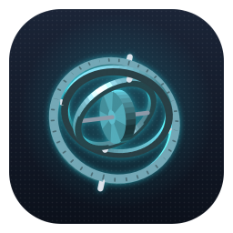

# Gyre

A tiled, keyboard-first desktop UI for the [omp](https://github.com/can1357/oh-my-pi) coding agent.

- **Agent:** omp, unmodified. All of its tools, slash commands, skills, MCP servers, sessions and model providers are available.
- **UX:** five themes (Graphite, Riso, Phosphor, Dune, Dusk) and a live gyroscope that shows what your agents are doing; auto-tiling panes with a hidden-pane bar, floating panes and workspace minimaps; tinted event cards; keyboard mode, jump marks and palettes; plan review with Plannotator; objectives, event graph, task manager, Agent Studio, MCP and model-role settings; phone layout and remote access.
- **Plan mode:** omp's plan mode is TUI-only, so Gyre ships a small omp extension (`packages/omp-extension`) that brings the same workflow to RPC: plan on the plan-role model, review (in Plannotator when installed), refine, then approve with the role and context handling you pick.
- Shell access in plan mode follows omp’s instruction-based policy. File-tool writes are restricted, but shell commands are not sandboxed.
- **Upstream:** Gyre drives omp over its versioned RPC protocol and never forks it. See [Tracking omp upstream](docs/architecture.md#tracking-omp-upstream).

## Install

```bash
curl -fsSL https://raw.githubusercontent.com/oOSomnus/gyre/main/install.sh | bash
```

The installer is a short guided setup in your terminal:

1. **Pick a version:** **Web** (a local server that opens Gyre in your browser, and is reachable from your phone if you enable remote access), the **Desktop app** (Linux x64: `.deb` via apt, or an AppImage without sudo), or both.
2. **omp:** if the omp coding agent is missing, it offers to install the version this release is tested with (via Bun, installing Bun first if needed).
3. **Plannotator (optional):** offers the Plannotator plugin for richer plan review.
4. **First model provider:** if omp has none, it offers to run `omp login` or to store an API key, or prints the commands for later.

Downloads come from the latest [GitHub release](https://github.com/oOSomnus/gyre/releases) and are checked against its `SHA256SUMS`. The web version runs on Linux and macOS (x64 and arm64).

Then start Gyre:

- **Web:** `gyre` starts the server and opens the UI in your browser. `gyre --no-open` prints the `http://127.0.0.1:7341/#token=…` URL instead; Ctrl-C stops it.
- **Desktop:** launch "Gyre" from your app menu.

**Installer options.** Pass flags after `bash -s --`, e.g. `curl -fsSL …/install.sh | bash -s -- --web --with-plannotator --yes`:

| Flag | Effect |
|---|---|
| `--web`, `--desktop`, `--both` | What to install (default: ask) |
| `--install-omp`, `--no-omp` | Install omp if missing without asking, or skip the omp step |
| `--with-plannotator`, `--no-plannotator` | Install Plannotator without asking, or skip it |
| `--version vX.Y.Z` | A specific release instead of the latest |
| `--yes` | Accept the recommended answer for every question (never prompts for sudo) |
| `--uninstall` | Remove what the installer added; keeps your data in `~/.gyre` |

Install locations: the web version goes to `~/.local/share/gyre` with the launcher at `~/.local/bin/gyre` (`GYRE_INSTALL_DIR`, `GYRE_BIN_DIR` override them); the AppImage goes to `~/.local/bin/Gyre.AppImage` with a menu entry. To uninstall by hand: `rm -rf ~/.local/share/gyre ~/.local/bin/gyre ~/.local/bin/Gyre.AppImage ~/.local/share/applications/gyre.desktop`, or `sudo apt remove gyre` for the `.deb`. Gyre's own data (projects, workspaces) lives in `~/.gyre`.

### Installing omp manually

Gyre needs [omp](https://omp.sh) (`omp` on `PATH`, or set `OMP_PATH`). To install it yourself:

```bash
curl -fsSL https://bun.sh/install | bash          # Bun, if you don't have it
bun install -g @oh-my-pi/pi-coding-agent           # omp (pin a version with @x.y.z)
omp --version
```

Gyre also detects omp in `~/.bun/bin`, `~/.local/bin`, `/usr/local/bin` and `/opt/homebrew/bin`, since desktop launchers often start apps without your shell's `PATH`.

### Installing Plannotator manually (optional)

[Plannotator](https://github.com/backnotprop/plannotator) adds a visual plan-review page (annotate, comment, approve). Gyre embeds it in the Plan pane when it is installed and falls back to its own review card otherwise.

```bash
omp plugin install @plannotator/pi-extension
```

Restart open chats afterwards (Task Manager → Restart) so they load the plugin.

### Configuring your first provider

omp refuses to start without at least one model provider, so Gyre shows setup steps (and an "Add a provider" chip in the top bar) until one is configured. Use any of these in a terminal, then press **Re-check** in Gyre:

- **Sign in with a subscription** (Claude Pro/Max, ChatGPT Plus/Pro via Codex, GitHub Copilot, …):

  ```bash
  omp login            # pick a provider, follow the sign-in link
  ```

- **Store an API key with omp.** This works for the desktop app too. The key is read without echo and passed on stdin, so it stays out of your shell history:

  ```bash
  read -rsp 'API key: ' KEY && printf '{"version":1,"credentials":[{"provider":"anthropic","credential":{"type":"api_key","key":"%s"}}]}' "$KEY" | omp auth import - ; unset KEY
  ```

  Use the provider id that matches your key: `anthropic`, `openai`, `google` (Gemini), `openrouter`, …

- **Environment variables** such as `ANTHROPIC_API_KEY`, `OPENAI_API_KEY`, `GEMINI_API_KEY` or `OPENROUTER_API_KEY` also work, but only if they are set in the environment Gyre starts from (restart Gyre after setting them).

- **A local or custom OpenAI-compatible endpoint** (Ollama, vLLM, LM Studio, …) in `~/.omp/agent/models.yml`:

  ```yaml
  providers:
    local:
      baseUrl: http://127.0.0.1:11434/v1
      apiKey: none
      api: openai-completions
      models:
        - id: qwen2.5-coder:14b
  ```

Once omp has a provider, Settings → Providers also lets you sign in to more accounts from inside Gyre.

## Projects

A project is a folder on the machine running Gyre; chats, terminals and the file viewer run inside it. **Add project** (top bar, palette, or Settings → Projects) opens a folder browser: click through folders (git repositories are marked), filter by typing, or paste a path. **Settings → Projects** (palette: "Manage projects…") lists every project, where you can rename it, start a chat, or remove it. Removing a project stops its chats and terminals and closes its panes; files on disk are never touched.

## Remote access

```bash
GYRE_HOST=0.0.0.0 GYRE_ALLOWED_HOSTS=my-laptop.tailnet.ts.net GYRE_TOKEN='replace-with-a-long-secret' gyre --no-open
# from source: same variables, then bun packages/gateway/src/main.ts
```

Open `http://my-laptop.tailnet.ts.net:7341/#token=<secret>` once on the other device; a 30-day HttpOnly cookie remembers it. SSH port forwarding needs no settings.

## Development

### Requirements

- [omp](https://omp.sh) with at least one provider (see above)
- Bun ≥ 1.4.4 (this repo pins 1.4.5)
- For the desktop build: Rust, plus Tauri's Linux deps (webkit2gtk-4.1)

### Run from source (browser)

```bash
bun install
bun run --cwd packages/web build
bun packages/gateway/src/main.ts      # prints: Open Gyre: http://127.0.0.1:7341/#token=…  (add --open to open it)
```

To work on the UI with hot reload:

```bash
GYRE_TOKEN=dev bun packages/gateway/src/main.ts
VITE_GYRE_TOKEN=dev bun run --cwd packages/web dev   # http://127.0.0.1:5173
```

### Desktop app from source

```bash
bun install --cwd apps/desktop
bun scripts/build-desktop.ts --bundles deb    # → apps/desktop/src-tauri/target/release/bundle/deb/*.deb
# development:
bun scripts/build-desktop.ts --sidecar-only && (cd apps/desktop && ./node_modules/.bin/tauri dev)
```

### Releases

```bash
bun scripts/build-release.ts --target linux-x64      # web tarball(s), manifest and checksums in dist/release
GYRE_RELEASE_BASE=file://$PWD/dist/release bash install.sh --web --no-omp --yes   # try the installer locally
git tag v0.2.0 && git push origin v0.2.0             # CI builds every target plus .deb/AppImage and publishes the release
```

### Tests

```bash
bun run test                           # omp extension tests + gateway unit tests (fake omp) + contract tests (real omp)
# UI end-to-end (no model calls), against a running gateway:
GYRE_TOKEN=e2e GYRE_OMP_ARGS=--no-session GYRE_PORT=7399 GYRE_DATA_DIR=$(mktemp -d) \
  bun packages/gateway/src/main.ts &
bun packages/e2e/run.ts          # uses packages/e2e/fixtures/demo-project
```

### Upgrading omp

```bash
bun scripts/bump-omp.ts      # match the installed omp; runs typecheck + tests + contract
```

## Docs

- [docs/ux-spec.md](docs/ux-spec.md): screen inventory, keyboard map, and which omp command or event drives each element
- [docs/architecture.md](docs/architecture.md): gateway, wire protocol, state, desktop shell, and the no-fork rules with the coupling points guarded by tests

## Licensing

- omp is MIT licensed (© Mario Zechner and contributors) and runs as a separate, unmodified program.
- Fonts: Space Grotesk and JetBrains Mono (SIL Open Font License), bundled through `@fontsource`.
- Plannotator is optional; when its omp extension is installed Gyre embeds its review page.
